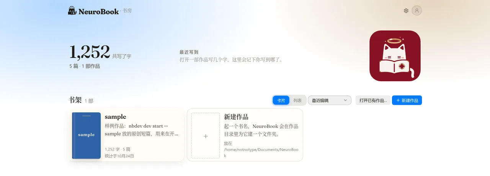
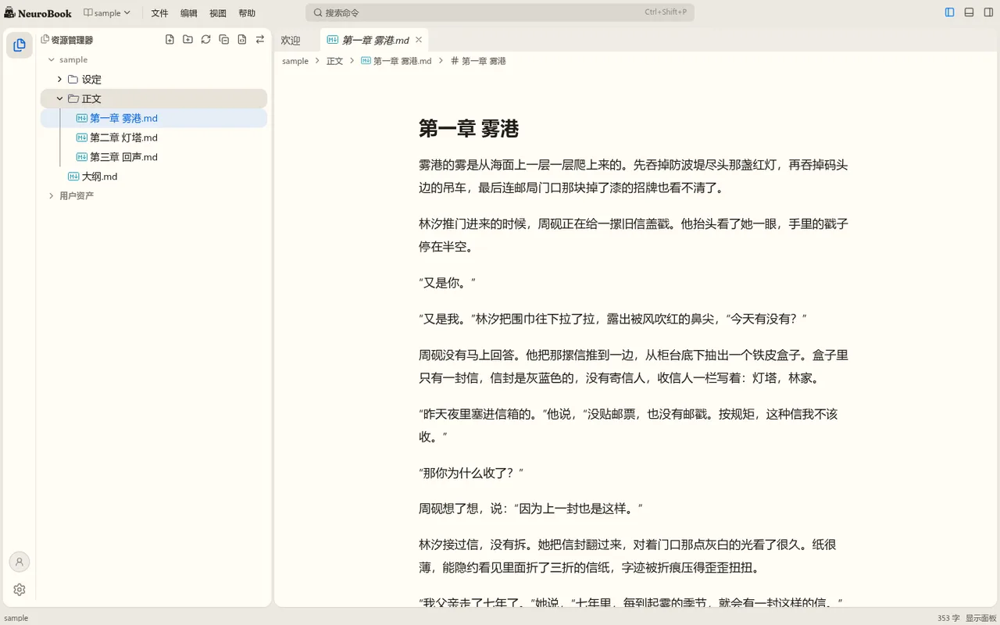

<div align="center">

<picture>
  <source media="(prefers-color-scheme: dark)" srcset="docs/images/readme/neurobook-lockup-horizontal-reversed.svg" />
  
</picture>

**用工程的方法，写完你的长篇**

[安装](#安装与启动) · [写插件](#写插件) · [路线图](#路线图) · [Discord](https://discord.gg/bSQB7mNpHB) · QQ 群 287447372

[](https://www.npmjs.com/package/@notnotype/neuro-book)
[](LICENSE)
[](https://discord.gg/bSQB7mNpHB)


**简体中文** · [English](README.en.md)

</div>


每个人心里都有一部长篇，但绝大多数死在半路——不是死于没天赋，是死于没有工程。NeuroBook 想把软件工程三十年的实践和创意写作一百年的方法论，做成你和 AI 共用的同一套工具。你的作品是本地的 Markdown 文件，随时带走。

> [!NOTE]
> **现在是 v2 预览版（0.11）。** NeuroBook 正在按 [NeuroBook v2：并排重建应用](docs/proposals/neuro-book-v2-rebuild.md) 从零重建：先把工作台、文件与编辑器、设置和插件这层底座做扎实，再把 AI 写作、世界引擎、剧情工坊一项项搬上来（见[路线图](#路线图)）。软件和接口还会变，欢迎反馈。

<br clear="right" />

## 安装与启动

需要 [Bun](https://bun.sh) 1.3.14 或更新的版本（NeuroBook 只在 Bun 上运行）。

```sh
bun add -g @notnotype/neuro-book
nbook
```

`nbook` 在前台启动本地服务并打开浏览器，按 Ctrl-C 停止；再运行一次会打开已经在运行的那个。服务只监听本机，远程机器上用 `ssh -L 4217:127.0.0.1:4217 <机器>` 转发。数据放在平台的数据目录（Linux 是 `~/.local/share/neuro-book`），作品目录缺省在文档目录下的 `NeuroBook`。选项、数据位置与升级见[应用包的说明](packages/neuro-book/scripts/app-package/README.md)。

## 现在能做什么

- **书架**：没有打开作品时的首页，案头有统计、最近写到哪里和看板娘；新建作品、打开已有的目录、改封面与信息。
- **工作台**：活动栏、侧栏、编辑区、面板与状态栏，视图可以拖到别处、最大化，布局会被记住；命令面板（`Ctrl/Cmd+Shift+P`）与快速打开。
- **文件**：资源管理器管普通、内容与活页夹三类文件夹，拖放、重命名、批量操作，外部改了文件即时同步。
- **编辑器**：Markdown 编辑器按作品的方言读写（中文排版规则、认不出的语法原样保留），另有源码编辑器、图片查看器与沙箱里的 HTML 预览；没保存的改动在切换、关闭时提醒。
- **设置**：设置窗口按分区组织，用户层与作品层分开，也可以直接编辑设置文件。
- **插件**：工作台的视图、命令、菜单、状态栏、设置分区都对插件开放，内置功能也是同一套插件写的。插件页或 `nbook plugin install` 安装，重启后生效。





## 写插件


插件用 TypeScript 与 Vue 写，SDK 包 `@notnotype/nb-plugin-sdk` 带作者命令 `nbooke`，不用全局安装：

```sh
bunx -p @notnotype/nb-plugin-sdk nbooke create my-plugin
cd my-plugin && bun install
bun run build
nbook plugin install dist
```

生成的插件在侧栏放一个视图、在命令面板加一条命令、在设置里加一项，改一改就是你自己的。作者文档、可用的 API 与示例插件见 [SDK 的作者文档](packages/neuro-book/plugin-sdk/README.md)。插件完全受信任，能访问全部作品与本机资源，只装你信任的来源。

## 路线图


AI 能写好一段文字，但写不好一部长篇：设定靠对话记忆，越写越漂移；第 3 章埋的伏笔第 200 章还没收；一股 AI 味；正文、设定、剧情讨论散在三个工具里。旧版本（0.10.x）把这些当作工程问题做过一遍，v2 会在新的底座上逐项重建。下面这些**还不在 v2 里**：

- **AI 写作工作室**：leader 规划与调度、writer 专职正文、researcher 查资料；讨论、计划、执行三种模式，切换都要你点头；编辑器里选中即改。
- **World Engine**：用“时间线 + 切面”做事件溯源，任意时刻任意人物、门派、王国的状态都由之前的变更推算得出，补设定就是插入一个切面。
- **剧情工坊**：承载树管故事在哪讲，因果树管为什么发生；伏笔作为“承诺”记账，埋下、推进、兑现全程跟踪；创作决策当场记档。
- **llmlint**：像 eslint 检查代码一样检查稿件，360 条规则覆盖填充词、机械过渡、公式化排比等 AI 写作痕迹。现在可以单独用：[notnotype/llmlint](https://github.com/notnotype/llmlint)。
- **桌面版**：独立窗口、自带运行时，不用先装 Bun。

已经能单独用的：剧情图谱 `nbstory`，把小说抽成按阅读位置可查、不剧透的记忆图，有命令行、网页查看器、内置问答和给 Claude Code、Codex 用的 Skill（`bun add -g @notnotype/nb-story`，见 [nb-story](packages/nb-story/README.md)）。

每个设计都有出处，一边是软件工程验证过的实践，一边是创意写作沉淀的理论：

| NeuroBook 功能  | 软件工程血统                              | 创意写作血统                                   |
| --------------- | ----------------------------------------- | ---------------------------------------------- |
| World Engine    | 事件溯源（Event Sourcing，Martin Fowler） | 设定圣经（Story Bible）                        |
| 承诺系统        | 技术债追踪（Ward Cunningham）             | 契诃夫之枪、桑德森「承诺 / 推进 / 兑现」三法则 |
| 章节信息控制    | 最小权限 / 信息隔离                       | 希区柯克「桌下炸弹」悬念理论                   |
| 承载树 / 因果树 | 关注点分离                                | fabula / sjuzhet（故事与叙述分离）             |
| 创作决策记录    | ADR（Michael Nygard）                     | 金圣叹、脂砚斋的评点传统                       |
| llmlint         | lint（贝尔实验室，1978）                  | 奥威尔《政治与英语》                           |
| 三模式 + 审批   | Code Review、plan / apply                 | 编辑部三审制                                   |

## 旧版本

0.10.x（Windows 免安装包、NeuroBook Manager、Docker）见 [Releases](https://github.com/notnotype/neuro-book/releases)，不再维护；当时的文档在 [`docs/archived/`](docs/archived/vitepress/locales/zh-Hans/index.md)。

## npm 包

都发布在 npm 的 `@notnotype` 下，只用 Bun 运行，许可证 AGPL-3.0-only。应用与 SDK 发构建产物（[ADR 0033](docs/adr/0033-app-delivered-as-built-npm-package.md)），其余以源码发布（[ADR 0029](docs/adr/0029-workspace-packages-publish-source-to-npm.md)）。

| 包 | 内容 |
|---|---|
| [`@notnotype/neuro-book`](packages/neuro-book/scripts/app-package/README.md) | NeuroBook 应用与命令 `nbook` |
| [`@notnotype/nb-plugin-sdk`](packages/neuro-book/plugin-sdk/README.md) | 插件 SDK 与作者命令 `nbooke` |
| [`@notnotype/nb-story`](packages/nb-story/README.md) | 剧情图谱：`nbstory` 命令行、本机网页查看器与问答、外部 Agent 的 Skill |
| [`@notnotype/nb-harness`](packages/nb-harness/README.md) | Agent harness：Profile、工具与一次运行 |
| [`@notnotype/nb-profile`](packages/nb-profile/README.md) | Profile 的定义、加载与 JSX 渲染 |
| [`@notnotype/nb-session`](packages/nb-session/README.md) | Agent 会话日志 |
| [`@notnotype/nb-runtime`](packages/nb-runtime/README.md) | 内核：生命周期、服务装配、插件、启动门禁、诊断、远程服务 |
| [`@notnotype/nb-ui`](packages/nb-ui/README.md) | Vue 基础组件与主题（宿主用 Vite 与 Tailwind v4 编译） |
| [`@notnotype/nb-agent-ui`](packages/nb-agent-ui/README.md) | Agent 对话视图 |
| [`@notnotype/nb-form`](packages/nb-form/README.md) | 按数据 schema 画表单 |
| [`@notnotype/nb-markdown`](packages/nb-markdown/README.md) | Markdown 的语言、编解码器与组件 |

## 参与开发

从源码运行：仓库根 `bun install`，到 `packages/neuro-book` 里 `bun run dev`。各包的职责与依赖方向见 [Monorepo Module 边界](docs/modules/monorepo-boundaries.md)，开发流程见[贡献指南](CONTRIBUTING.md)，仓库现状见 [PROJECT-STATUS.md](PROJECT-STATUS.md)。

- 应用：[NeuroBook](packages/neuro-book/README.md) · [内核 nb-runtime](packages/nb-runtime/README.md) · [旧应用（只作参照）](packages/neuro-book-legacy/AGENTS.md)
- 前端共享包：[nb-ui](packages/nb-ui/README.md) · [nb-form](packages/nb-form/README.md) · [nb-markdown](packages/nb-markdown/README.md) · [nb-agent-ui](packages/nb-agent-ui/README.md)
- Agent：[nb-harness](packages/nb-harness/README.md) · [nb-profile](packages/nb-profile/README.md) · [nb-session](packages/nb-session/README.md) · [neuro-agent-harness（已冻结）](packages/neuro-agent-harness/README.md) · [llmlint（准备退役）](packages/llmlint/README.md)
- 领域包：[nb-story](packages/nb-story/README.md) · [nb-history](packages/nb-history/README.md) · [nb-workflow](packages/nb-workflow/README.md) · [nb-memory](packages/nb-memory/README.md)
- 基础与工具：[owned-process](packages/owned-process/README.md) · [file-snapshot-cache](packages/file-snapshot-cache/README.md) · [neuro-book-contracts](packages/neuro-book-contracts/README.md) · [neuro-book-test-support](packages/neuro-book-test-support/README.md) · [dev-panel（nbdev）](packages/dev-panel/README.md)

## 社区

- LINUX DO：https://linux.do/
- 💬 Discord：https://discord.gg/bSQB7mNpHB
- 🐧 QQ 讨论群（有猫娘）：287447372

欢迎来聊——功能建议、问题反馈，或者只是聊聊你正在写的书。

## 贡献

参与项目贡献，请先阅读[贡献指南](CONTRIBUTING.md)。

> [!NOTE]
> **加入 NeuroBook 项目组，成为核心开发者**

如果你很看好 NeuroBook 的方向，并且充足的时间，希望深入参与到 NeuroBook 的开发中。欢迎加入 NeuroBook 项目。

> 并不一定需要会开发，深度使用用户也可以加入哦

目前 NeuroBook 在这些地方需优化：

- 提示词工程：需要写作专家和提示词专家来优化 NeuroBook 的提示词。跑通并优化小说创作流程
- 前端、UI、设计：NeuroBook 的 UI 语言急需重新设计，并计划对客户端界面进行重构
- 社区建设与管理
- 文档与教程整理
- 测试

申请方式：发邮件到 notnotype@gmail.com 

## 许可证

NeuroBook 是采用 [GNU Affero General Public License v3.0（仅此版本）](LICENSE) 的自由开源软件，SPDX 标识为 `AGPL-3.0-only`。该许可证允许使用、研究、修改、分发和商业使用；分发修改版或通过网络向用户提供修改版服务时，需要依照 AGPLv3 提供对应源代码。

标志、字标与看板娘等品牌图片随仓库按同一许可提供（[来源](docs/images/readme/README.md)）。用户使用 NeuroBook 创作、编辑或发表的原创作品不会仅因使用本软件而自动适用 AGPL。仓库中另有许可证声明的独立第三方组件继续适用各自的许可证。Copyright © 2026 notnotype。

## Star History

<a href="https://www.star-history.com/?repos=notnotype%2Fneuro-book&type=date&legend=top-left">
 <picture>
   <source media="(prefers-color-scheme: dark)" srcset="https://api.star-history.com/chart?repos=notnotype/neuro-book&type=date&theme=dark&legend=top-left&sealed_token=ago-VvdvFFQoL3gwjchdv-mcsM5c6Jq5jL8IHxVu4HwYL6d45RujQKDxAzgV-pzxLGddtmU92wJo44_ZhFx-zOI0MXUc46jN6Dq27ZwiLyXfoBdUYSJlVQ" />
   <source media="(prefers-color-scheme: light)" srcset="https://api.star-history.com/chart?repos=notnotype/neuro-book&type=date&legend=top-left&sealed_token=ago-VvdvFFQoL3gwjchdv-mcsM5c6Jq5jL8IHxVu4HwYL6d45RujQKDxAzgV-pzxLGddtmU92wJo44_ZhFx-zOI0MXUc46jN6Dq27ZwiLyXfoBdUYSJlVQ" />
   
 </picture>
</a>
